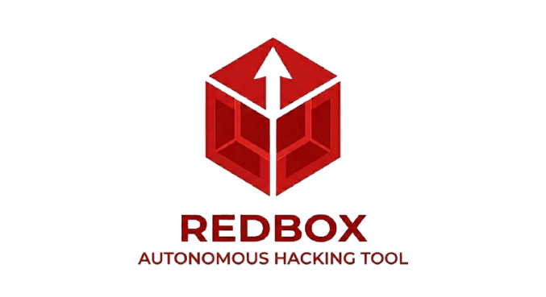

<<<<<<< HEAD
# 🔴 RedBox - AI-Powered Security Orchestration Platform

<div align="center">
  

  **Next-Generation Security Testing Platform powered by AI**

  [](LICENSE)
  [](https://www.typescriptlang.org/)
  [](https://reactjs.org/)
  [](https://nodejs.org/)
  [](https://www.python.org/)
</div>

---

## 📖 Overview

**RedBox** is a comprehensive AI-powered security testing orchestration platform that combines multiple LLM providers with advanced penetration testing capabilities. It provides a unified interface for security assessments, knowledge management, and automated testing workflows.

### 🎯 Key Features

- **🤖 AI Orchestrator**: Multi-stage security assessment pipelines with LLM-powered analysis
- **💻 AI Terminal**: Interactive security assistant with real-time streaming responses
- **📚 RAG Advisor**: Query your security knowledge base with AI-enhanced retrieval
- **🔌 MCP Integration**: HexStrike Model Context Protocol for actual security tool execution
- **📊 Report Generation**: Automated executive, technical, and full security reports
- **🔄 Multi-LLM Support**: Ollama, OpenAI, Anthropic Claude, Google Gemini, and custom endpoints
- **🧠 Neo4j Graph Store**: Optional Neo4j integration for attack paths, host/service context, and vulnerability graph persistence.

---

## 🏗️ Architecture

```
RedBox/
├── redbox-ops-core/          # Main application
│   ├── backend/              # Express + TypeScript backend
│   │   ├── src/
│   │   │   ├── routes/       # API endpoints
│   │   │   ├── services/     # Core services (LLM, RAG, Orchestrator)
│   │   │   └── db.ts         # SQLite database
│   │   └── prompts/          # Security testing templates
│   └── src/                  # React + TypeScript frontend
│       ├── components/       # UI components
│       ├── pages/            # Application pages
│       ├── context/          # State management
│       └── services/         # API clients
└── hexstrike/                # MCP server for security tools
    └── hexstrike-ai/         # Python-based tool execution server
```

---

## 🚀 Quick Start

### Prerequisites

- **Node.js** 18+ and npm
- **Python** 3.8+ (for HexStrike MCP server)
- **Neo4j** 5.x (optional, for graph persistence and attack path analysis)
- **Ollama** (optional - for local LLM) or API keys for cloud LLMs

### Installation

#### 1. Clone the Repository

```bash
git clone https://github.com/H3DD4/RedBox.git
cd RedBox
```

#### 2. Setup Frontend & Backend

```bash
cd redbox-ops-core

# Install frontend dependencies
npm install

# Install backend dependencies
cd backend
npm install
cd ..
```

#### 3. Configure Environment

```bash
# Frontend
cp .env.example .env

# Backend
cp backend/.env.example backend/.env
```

Edit `.env` files with your configuration:
- Database path
- API ports
- LLM provider endpoints
- Neo4j connection settings in `redbox-ops-core/backend/.env` if using graph persistence

Example backend Neo4j variables:
```bash
NEO4J_URI=bolt://localhost:7687
NEO4J_USER=neo4j
NEO4J_PASSWORD=your-password
NEO4J_DATABASE=neo4j
```

#### 4. Setup Neo4j Graph Store (Optional)

You can start Neo4j directly with Docker:

```bash
docker run -p 7474:7474 -p 7687:7687 -e NEO4J_AUTH=neo4j/password neo4j:latest
```

Or use the included Docker Compose service:

```bash
docker compose up --build
```

Then initialize the Neo4j schema from the backend folder:

```bash
cd redbox-ops-core/backend
npm install
npm run neo4j:init
```

#### 5. Setup HexStrike MCP Server (Optional)

```bash
cd ../hexstrike/hexstrike-ai

# Create virtual environment
python -m venv venv
source venv/bin/activate  # On Windows: venv\Scripts\activate

# Install dependencies
pip install -r requirements.txt
```

Optional helper scripts (create .venv and install deps):

```bash
# Windows PowerShell
./scripts/setup-venv.ps1

# Linux/Mac
./scripts/setup-venv.sh
```

#### 6. Start the Platform

**Terminal 1 - Backend:**
```bash
cd redbox-ops-core/backend
npm run dev
```

**Terminal 2 - Frontend:**
```bash
cd redbox-ops-core
npm run dev
```

**Terminal 3 - HexStrike MCP (Optional):**
```bash
cd hexstrike/hexstrike-ai
python hexstrike_server.py
```

#### 7. Access RedBox

Open your browser and navigate to:
```
http://localhost:5173
```

**Default Login:**
- Email: `admin@redbox.io`
- Password: `redbox`

---

## 🐳 Docker Compose (Recommended)

Run the full stack with Docker (includes Neo4j):

```bash
docker compose up --build
```

Optional HexStrike MCP server (heavier build):

```bash
docker compose --profile hexstrike up --build
```

**Notes:**
- Frontend: `http://localhost:5173`
- Backend: `http://localhost:3001`
- HexStrike (optional): `http://localhost:8888`
- Neo4j: `http://localhost:7474` and `bolt://localhost:7687`
- To point the backend at a host-run HexStrike, set `HEXSTRIKE_API_URL` in a root `.env` file.

---

## 💡 Usage

### 1. **Configure LLM Provider**
- Navigate to **Settings** → **LLM Providers**
- Add your preferred provider (Ollama, OpenAI, Claude, etc.)
- Test connection and set as active

### 2. **Run Security Assessment**
- Go to **Orchestrator**
- Select pipeline (CTF Solving, Pentest, etc.)
- Enter target and test parameters
- Watch real-time AI analysis

### 3. **Query Knowledge Base**
- Upload security documents in **RAG Advisor**
- Ask questions about your knowledge base
- Get AI-powered answers with sources

### 4. **Interactive Terminal**
- Use **AI Terminal** for ad-hoc security queries
- Stream responses in real-time
- Execute security analysis on-the-fly

---

## 🛠️ Technology Stack

### Frontend
- **React 18** with TypeScript
- **Vite** for blazing-fast builds
- **TailwindCSS** for styling
- **shadcn/ui** component library
- **React Query** for state management

### Backend
- **Express.js** with TypeScript
- **SQLite** with better-sqlite3
- **Neo4j** graph persistence via `neo4j-driver`
- **JWT** authentication
- **Server-Sent Events (SSE)** for streaming
- **Multer** for file uploads

### AI/ML
- **Multiple LLM Providers**: OpenAI, Anthropic, Gemini, Ollama
- **RAG Engine**: TF-IDF + Provider embeddings
- **Streaming Chat**: Real-time response streaming
- **Prompt Templates**: Structured security testing workflows

### Security Tools
- **HexStrike MCP Server**: Python-based tool execution
- **Model Context Protocol**: Standardized AI-tool communication

---

## 📁 Project Structure

```
redbox-ops-core/
├── backend/
│   ├── src/
│   │   ├── routes/           # API endpoints
│   │   │   ├── auth.ts       # Authentication
│   │   │   ├── orchestrator.ts  # Pipeline execution
│   │   │   ├── rag.ts        # RAG queries
│   │   │   ├── llm-providers.ts  # LLM management
│   │   │   └── ...
│   │   ├── services/
│   │   │   ├── orchestrator.ts   # Core orchestration logic
│   │   │   ├── rag-engine.ts     # RAG implementation
│   │   │   ├── llm-gateway.ts    # Multi-LLM interface
│   │   │   ├── neo4j.ts          # Graph persistence service
│   │   │   ├── prompt-engine.ts  # Template system
│   │   │   └── report-generator.ts
│   │   ├── db.ts             # Database schema
│   │   └── index.ts          # Server entry point
│   └── prompts/              # Security testing templates
│       ├── ctf-solving/
│       ├── real-pentesting/
│       └── shared/
└── src/
    ├── pages/
    │   ├── Dashboard.tsx     # Overview
    │   ├── Orchestrator.tsx  # Pipeline management
    │   ├── Terminal.tsx      # AI chat
    │   ├── RAGAdvisor.tsx    # Knowledge base
    │   └── SettingsPage.tsx  # Configuration
    ├── components/           # Reusable UI components
    ├── context/              # Global state
    └── services/             # API clients
```

---

## 🔐 Security Features

- **JWT Authentication**: Secure user sessions
- **Password Hashing**: bcrypt with salt
- **Shell Command Audit**: All commands logged
- **Blocklist**: Dangerous commands prevented
- **API Rate Limiting**: Protection against abuse
- **CORS Configuration**: Controlled cross-origin access

---

## 📚 Documentation

- **[MCP Integration Guide](MCP_INTEGRATION_GUIDE.md)**: HexStrike setup and usage
- **[HexStrike README](hexstrike/hexstrike-ai/README.md)**: Tool server documentation
- **Backend API**: RESTful endpoints with SSE streaming
- **Frontend**: Component-based React architecture

---

## 🤝 Contributing

Contributions are welcome! Please feel free to submit a Pull Request.

1. Fork the repository
2. Create your feature branch (`git checkout -b feature/AmazingFeature`)
3. Commit your changes (`git commit -m 'Add some AmazingFeature'`)
4. Push to the branch (`git push origin feature/AmazingFeature`)
5. Open a Pull Request

---

## 📝 License

This project is licensed under the MIT License - see the [LICENSE](LICENSE) file for details.

---


## 📧 Contact

**Project Link**: [https://github.com/H3DD4/RedBox](https://github.com/H3DD4/RedBox)

---

<div align="center">
  <sub>Developed by H3DD4</sub>
</div>
=======
# RedBox


## Getting started

To make it easy for you to get started with GitLab, here's a list of recommended next steps.

Already a pro? Just edit this README.md and make it your own. Want to make it easy? [Use the template at the bottom](#editing-this-readme)!

## Add your files

* [Create](https://docs.gitlab.com/user/project/repository/web_editor/#create-a-file) or [upload](https://docs.gitlab.com/user/project/repository/web_editor/#upload-a-file) files
* [Add files using the command line](https://docs.gitlab.com/topics/git/add_files/#add-files-to-a-git-repository) or push an existing Git repository with the following command:

```
cd existing_repo
git remote add origin https://gitlab.com/medhedda/RedBox.git
git branch -M main
git push -uf origin main
```

## Integrate with your tools

* [Set up project integrations](https://gitlab.com/medhedda/RedBox/-/settings/integrations)

## Collaborate with your team

* [Invite team members and collaborators](https://docs.gitlab.com/user/project/members/)
* [Create a new merge request](https://docs.gitlab.com/user/project/merge_requests/creating_merge_requests/)
* [Automatically close issues from merge requests](https://docs.gitlab.com/user/project/issues/managing_issues/#closing-issues-automatically)
* [Enable merge request approvals](https://docs.gitlab.com/user/project/merge_requests/approvals/)
* [Set auto-merge](https://docs.gitlab.com/user/project/merge_requests/auto_merge/)

## Test and Deploy

Use the built-in continuous integration in GitLab.

* [Get started with GitLab CI/CD](https://docs.gitlab.com/ci/quick_start/)
* [Analyze your code for known vulnerabilities with Static Application Security Testing (SAST)](https://docs.gitlab.com/user/application_security/sast/)
* [Deploy to Kubernetes, Amazon EC2, or Amazon ECS using Auto Deploy](https://docs.gitlab.com/topics/autodevops/requirements/)
* [Use pull-based deployments for improved Kubernetes management](https://docs.gitlab.com/user/clusters/agent/)
* [Set up protected environments](https://docs.gitlab.com/ci/environments/protected_environments/)

***

# Editing this README

When you're ready to make this README your own, just edit this file and use the handy template below (or feel free to structure it however you want - this is just a starting point!). Thanks to [makeareadme.com](https://www.makeareadme.com/) for this template.

## Suggestions for a good README

Every project is different, so consider which of these sections apply to yours. The sections used in the template are suggestions for most open source projects. Also keep in mind that while a README can be too long and detailed, too long is better than too short. If you think your README is too long, consider utilizing another form of documentation rather than cutting out information.

## Name
Choose a self-explaining name for your project.

## Description
Let people know what your project can do specifically. Provide context and add a link to any reference visitors might be unfamiliar with. A list of Features or a Background subsection can also be added here. If there are alternatives to your project, this is a good place to list differentiating factors.

## Badges
On some READMEs, you may see small images that convey metadata, such as whether or not all the tests are passing for the project. You can use Shields to add some to your README. Many services also have instructions for adding a badge.

## Visuals
Depending on what you are making, it can be a good idea to include screenshots or even a video (you'll frequently see GIFs rather than actual videos). Tools like ttygif can help, but check out Asciinema for a more sophisticated method.

## Installation
Within a particular ecosystem, there may be a common way of installing things, such as using Yarn, NuGet, or Homebrew. However, consider the possibility that whoever is reading your README is a novice and would like more guidance. Listing specific steps helps remove ambiguity and gets people to using your project as quickly as possible. If it only runs in a specific context like a particular programming language version or operating system or has dependencies that have to be installed manually, also add a Requirements subsection.

## Usage
Use examples liberally, and show the expected output if you can. It's helpful to have inline the smallest example of usage that you can demonstrate, while providing links to more sophisticated examples if they are too long to reasonably include in the README.

## Support
Tell people where they can go to for help. It can be any combination of an issue tracker, a chat room, an email address, etc.

## Roadmap
If you have ideas for releases in the future, it is a good idea to list them in the README.

## Contributing
State if you are open to contributions and what your requirements are for accepting them.

For people who want to make changes to your project, it's helpful to have some documentation on how to get started. Perhaps there is a script that they should run or some environment variables that they need to set. Make these steps explicit. These instructions could also be useful to your future self.

You can also document commands to lint the code or run tests. These steps help to ensure high code quality and reduce the likelihood that the changes inadvertently break something. Having instructions for running tests is especially helpful if it requires external setup, such as starting a Selenium server for testing in a browser.

## Authors and acknowledgment
Show your appreciation to those who have contributed to the project.

## License
For open source projects, say how it is licensed.

## Project status
If you have run out of energy or time for your project, put a note at the top of the README saying that development has slowed down or stopped completely. Someone may choose to fork your project or volunteer to step in as a maintainer or owner, allowing your project to keep going. You can also make an explicit request for maintainers.
>>>>>>> 5c886e418407f8809c17d4d145431eb0fbcf3800
