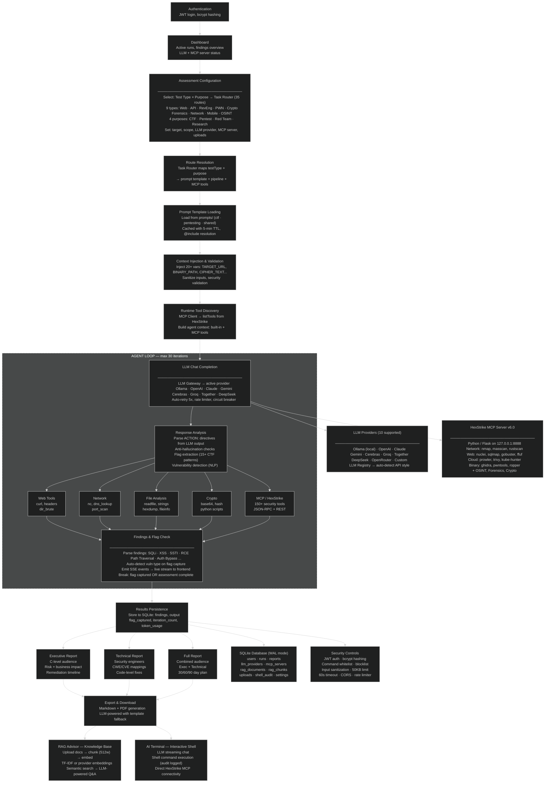
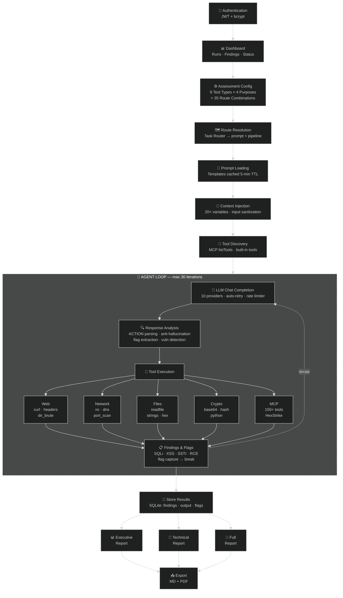

# RedBox — Functional Architecture (Mermaid)

## How to use
1. Go to https://mermaid.live
2. Copy the code below
3. Paste it in the editor
4. Click "Actions" → "Download PNG" or "Download SVG"
5. Change theme to "dark" in settings for dark background

---

---

## Alternative: Simple Vertical Version (Paste in mermaid.live)

If the above is too complex for Mermaid rendering, use this simpler linear version:

